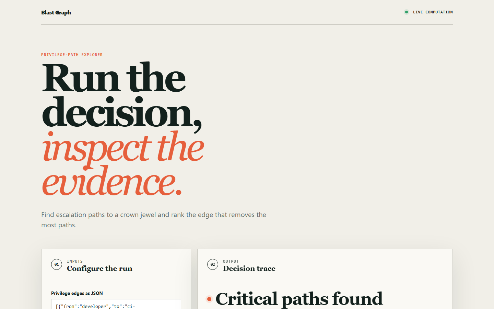
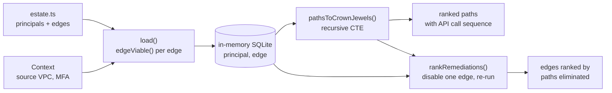

# blastgraph

Cloud IAM analysis that finds multi-hop privilege-escalation paths to crown-jewel resources and tells you which single permission to remove to break the most of them.

[](https://github.com/csalekhya/blastgraph/actions/workflows/ci.yml)
[Live demo](https://csalekhya.github.io/blastgraph/)



## Why

Reviewing IAM one policy at a time misses how breaches actually escalate. A deploy role can assume a CI role, which can assume a migration role, which can reach the customer database. Each role looks fine on its own, so a per-policy audit reports nothing, yet the estate is a few hops from its most sensitive data.

blastgraph models the estate as a directed graph of privilege edges and asks a reachability question instead: starting from a given principal, which tagged crown jewels can be reached, through which exact API calls, and which single edge removal eliminates the most paths.

## Features

- Principal, edge and crown-jewel model with typed edges (`ASSUME_ROLE`, `PASS_ROLE`, `DECRYPT`, `READ_SECRET`, `READ_DATA`, ...).
- Condition-aware pruning: edges gated on `aws:SourceVpc` or MFA, or excluded by a permission boundary, are removed for the attacker context, and the reason is recorded on the edge.
- Transitive reachability as a single recursive SQL query, with a per-path cycle guard and a hop limit.
- Each path is reported as the ordered list of API calls an attacker would make.
- Counterfactual ranking: disable each viable edge in turn, recompute, and rank edges by paths eliminated.
- A browser explorer (`site/`) that runs a path search and edge ranking on inputs you edit.

## Architecture



Edges are loaded into an in-memory SQLite database (`node:sqlite`). When an edge is loaded, `edgeViable` checks its permission boundary and condition keys against the attacker context and stores `viable = 0` plus a `pruned_by` explanation when the edge cannot be used. Reachability walks only viable edges. Remediation ranking toggles the `viable` flag on one edge at a time and recounts paths.

## Quick start

Prerequisite: Node.js 22.18 or newer (24 recommended). TypeScript runs through Node's built-in type stripping and the database is `node:sqlite`, so there is no build step and no dependencies to install.

```bash
git clone https://github.com/csalekhya/blastgraph
cd blastgraph
npm test        # unit tests for the engine and the site logic
npm run demo    # run the analysis on the sample estate
```

To open the explorer locally, serve the `site/` directory, for example `python3 -m http.server -d site 8000`, and visit http://localhost:8000.

## Example

`npm run demo` analyses the sample estate (14 principals, 19 privilege edges, 3 crown jewels) for an attacker holding `user:contractor` credentials from outside the corporate VPC and without MFA. Trimmed output:

```text
  What reachability reports: 6 paths to crown jewels

  [3 hops] resource:secrets-payments
      1. sts:AssumeRole role/dev-deploy
      2. iam:PassRole -> lambda:UpdateFunctionCode lambda-etl
      3. secretsmanager:GetSecretValue payments

  [4 hops] resource:rds-customers
      1. sts:AssumeRole role/dev-deploy
      2. sts:AssumeRole role/ci-runner
      3. sts:AssumeRole role/backup
      4. rds:CreateDBSnapshot customers

  Edges pruned as non-viable in this context (NOT reported as paths):
    user:analyst -> role:migration
      requires aws:SourceVpc=vpc-corp
    user:analyst -> role:backup
      requires MFA
    role:readonly-audit -> service:lambda-etl
      permission boundary excludes PASS_ROLE

  Single-edge removals, ranked by paths eliminated:
     6/6 (100%)  user:contractor -> role:dev-deploy
     4/6 ( 67%)  role:dev-deploy -> role:ci-runner
     2/6 ( 33%)  role:dev-deploy -> service:lambda-etl
```

## How it works

- **Viability.** A permission boundary on the source principal caps which edge kinds it may use. `aws:SourceVpc` must equal the attacker's VPC, and an MFA-gated edge is usable only when MFA is present. Pruned edges are kept in the table with the reason, so a reviewer can disagree with a decision.
- **Reachability.** The recursive CTE starts at the chosen principal and joins viable edges, accumulating the node path and the action list. It refuses to revisit a node already on the path, because IAM graphs contain cycles (two roles that can assume each other is a common misconfiguration) and without the guard the recursion would not terminate. `maxHops` (default 8) bounds the search.
- **Remediation ranking.** `rankRemediations` returns a ranked list rather than a single winner because the top edge is usually the attacker's own entry hop. That is correct but not an actionable fix, so the rows below it are the structural changes a platform team can make.
- **Ground truth.** The sample estate records the six planted escalation paths in `src/estate.ts`, and the tests assert that every one is found.

See [docs/ARCHITECTURE.md](docs/ARCHITECTURE.md) for design decisions and failure modes.

## Testing

```bash
npm test
```

The suite uses `node:test` and covers:

- recall of every planted path, and a bound on unplanted paths;
- paths of four or more hops, ordering by length, and the API call sequence on each path;
- pruning by VPC condition, MFA condition and permission boundary, including the recorded reason;
- cycle handling, the hop limit, principals with no outbound edges, and non-crown-jewel targets;
- remediation ranking, including that the recommended removal reduces reachability;
- the browser explorer's computation (`site/core.test.mjs`).

CI runs the same tests, validates the site with `scripts/validate_site.py`, and deploys `site/` to GitHub Pages.

## Project layout

```text
src/
  graph.ts        schema, edge viability, recursive reachability, remediation ranking
  estate.ts       sample estate and the planted ground-truth paths
  demo.ts         command-line walkthrough (npm run demo)
tests/            engine tests
site/             browser explorer, deployed to GitHub Pages
scripts/          site validation
docs/             architecture notes and screenshots
```

## Limitations

- It reads a modelled estate. It does not ingest live AWS accounts or Terraform state, and it never attempts an escalation.
- Edges and conditions are limited to the kinds in `graph.ts`. Resource policies, data-plane paths and other condition keys are out of scope.
- The sample estate is small and hand-built, so recall figures describe that estate, not real accounts.
- The browser explorer uses its own simplified edge format and does not evaluate conditions or boundaries.
- `node:sqlite` and type stripping are experimental in Node and print warnings.

## License

MIT, see [LICENSE](LICENSE).

## Maintainer

Originally developed by Sai Alekhya Chandramouli, this project is currently maintained by Sai Alekhya Chandramouli.

[LinkedIn](https://www.linkedin.com/in/alekhya-chandramouli/) · [Email](mailto:alekha.chandramouli@gmail.com)