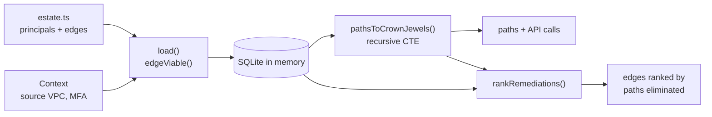

# Architecture

## Context

IAM review tools usually inspect policies one at a time. That hides escalation chains in which every individual grant looks reasonable but the composition reaches a sensitive resource. blastgraph treats the estate as a graph and answers a reachability question for a given attacker position.

## Container view

## Key decisions

**Reachability in SQL.** The traversal is a recursive CTE rather than hand-written graph code. It is declarative, short enough to review, and the database does the joining. The trade-off is that paths are built as delimited strings, which is simple but not the most compact representation for very large graphs.

**Prune at load time, keep the reason.** `edgeViable` evaluates permission boundaries, `aws:SourceVpc` and MFA conditions against the attacker context when edges are inserted. Non-viable edges stay in the table with a `pruned_by` message. Ignoring conditions produces paths that cannot happen, and over-pruning hides real ones, so the decision is made explicit and inspectable.

**Cycle guard per path.** A node is never revisited within one path. Cycles between roles are real, and the guard keeps the recursion finite. `maxHops` is a second bound.

**Ranked remediation, not a single best edge.** Each viable edge is disabled in turn and paths are recounted. The top result is typically the attacker's entry edge, so the full ranked list is returned and the lower rows are the structural fixes.

## Failure modes

- A condition key the model does not understand is ignored, which can over-report a path. Unsupported conditions are limited to those listed in `edgeViable`.
- A graph with many parallel routes can produce many paths. `maxHops` limits depth but not path count.
- Remediation ranking recomputes reachability once per viable edge, so cost grows with edges times paths.

## Out of scope

- Ingesting live cloud accounts or Terraform state.
- Resource policies, data-plane access and attack techniques outside the modelled edge kinds.
- Executing any action. The tool analyses a model and never attempts an escalation.
